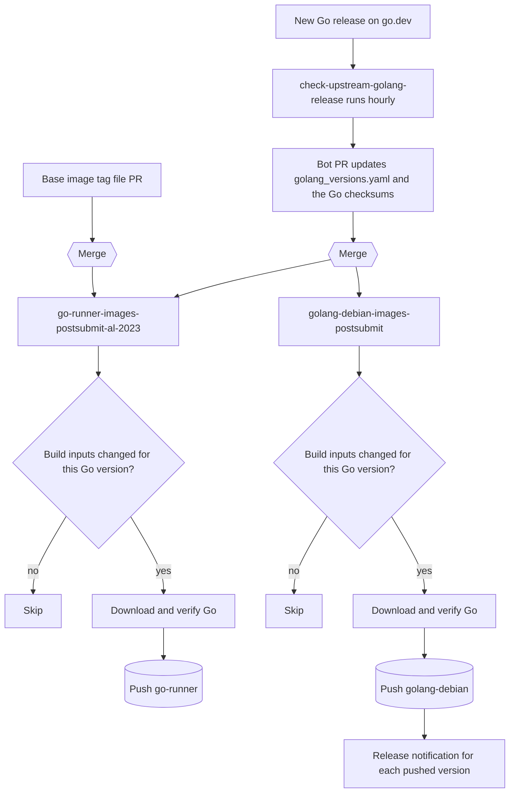

# go-runner and golang-debian images

This repository publishes two Go images to the [eks-distro-build-tooling ECR Public gallery](https://gallery.ecr.aws/eks-distro-build-tooling).

- [go-runner](https://gallery.ecr.aws/eks-distro-build-tooling/go-runner) is the Kubernetes `go-runner` binary from [kubernetes/release](https://github.com/kubernetes/release/tree/master/images/build/go-runner) on top of `eks-distro-minimal-base`. It is built for AL2023 on `linux/amd64` and `linux/arm64`, once for each supported Go version.
- [golang-debian](https://gallery.ecr.aws/eks-distro-build-tooling/golang-debian) is an upstream Go toolchain on a Debian base, built from [`projects/golang/go`](../golang/go) for each supported Go version on `linux/amd64`.

Prow postsubmits build both images when one of their inputs changes on `main`. Merging the Go version bot PR is the only manual step in a normal release.

## Workflow



## How a Go release is published

1. The `check-upstream-golang-release` periodic runs every hour. When go.dev lists a Go version that `eks-distro-base/golang_versions.yaml` does not have, it opens a bot PR that updates `eks-distro-base/golang_versions.yaml`, `builder-base/checksums` and `EKS_DISTRO_TAG_FILE.yaml`. If that PR is already open, the job updates it.
2. The presubmits `go-runner-images-presubmit-al-2023` and `golang-debian-images-presubmit` build every image on the PR without pushing.
3. A maintainer merges the PR, which starts `go-runner-images-postsubmit-al-2023` and `golang-debian-images-postsubmit`.
4. Each job loops over the Go versions in `eks-distro-base/golang_versions.yaml`, the same file the `golang` compiler images and builder-base are built from.
5. For each version, the job hashes the build inputs and compares the hash with the label on the published image. The job skips the version when the hash matches. When `PRIVATE_IMAGE_REPO` is set, the private image label must match too. A missing image counts as unbuilt, and any other registry error fails that version without pushing.
6. For each version that changed, the job downloads the toolchain from go.dev and verifies it. go-runner checks the archive against `builder-base/checksums` and compiles `go-runner` with it. golang-debian checks the archive against the sha256 published by go.dev and copies it into the image.
7. golang-debian sends a release notification for each version it pushed.

A failure in one Go version does not stop the others. The job builds the remaining versions and then fails, naming the versions that failed.

## Base image updates

go-runner also runs when `EKS_DISTRO_TAG_FILE.yaml` changes. The `eks-distro-minimal-base` tag is one of its build inputs, so merging a base image update rebuilds every go-runner version on the new base.

golang-debian is rebuilt on a new Debian base when `docker/debianBase/RELEASE` in [`projects/golang/go`](../golang/go) is incremented.

## Build inputs

| Image | Inputs |
|---|---|
| go-runner | go-runner `GIT_TAG`, Go patch version, Go archive checksum, `eks-distro-minimal-base` tag, this Makefile, the Dockerfile, the scripts in `build/`, and the shared build scripts it calls |
| golang-debian | Go patch version, Go archive checksum, the version `RELEASE` file, `docker/debianBase/RELEASE`, the Makefile, the Dockerfile, `get_upstream_golang.sh` and `scripts/image_build_inputs.sh` |

The hash is stored in the `eks-distro-build-tooling.build-inputs` image label. A Go version with no `RELEASE` file uses a release number of 1.

## Image tags

| Image | Tag | Example |
|---|---|---|
| go-runner | `<GIT_TAG>-go-<go patch>.2023` | `v0.18.0-go-1.26.11.2023` |
| go-runner | `<GIT_TAG>-go-<go minor>-latest.al23` | `v0.18.0-go-1.26-latest.al23` |
| golang-debian | `go<go patch>` | `go1.26.11` |
| golang-debian | `go<go patch>-<RELEASE>-<debianBase RELEASE>` | `go1.26.11-1-25` |

Each go-runner tag also has per-platform child tags such as `v0.18.0-go-1.26.11.2023-linux_amd64`.

When `PRIVATE_IMAGE_REPO` is set, the postsubmits also push the go-runner `<GIT_TAG>-go-<go patch>.2023` tag and the golang-debian `go<go patch>-<RELEASE>-<debianBase RELEASE>` tag to that private ECR registry. A failure to tag the private go-runner child images is logged as a warning and is not retried on later runs.

## Rebuilding manually

- To rebuild golang-debian, increment `docker/debianBase/RELEASE` in [`projects/golang/go`](../golang/go), or the `RELEASE` file of one Go version to rebuild only that version.
- To rebuild go-runner when no input changed, start the postsubmit with `FORCE_BUILD=true`.
- To resend golang-debian notifications for versions that were skipped, start the postsubmit with `NOTIFY_SKIPPED=true`.

A Prow rerun reuses the original job spec, so the last two options need a ProwJob with the environment variable added by hand.

## Building locally

Both commands build every Go version without pushing.

```bash
make -C projects/go-runner build IMAGE_REPO=public.ecr.aws/eks-distro-build-tooling
make -C projects/golang/go prod-release-images-upstream-bins-all PUSH_IMAGES=false IMAGE_REPO=public.ecr.aws/eks-distro-build-tooling
```

Both builds need `yq`, `jq`, `oras` and a running buildkit daemon.
